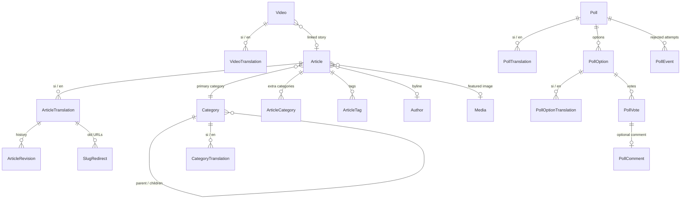

# RSnewslk.com: Project Handover

**As of:** 16 November 2026 (updated after the article management increment)
**Repository:** `sri-lanka-news-portal` (GitHub, private). Local working copy: `D:\RSNewslk`
**Owner:** Asela

This document describes the project as it exists in the code today. Anything
described as **built** has been implemented and checked; anything described as
**planned** has been discussed or specified but does not exist yet. When this
document and the code disagree, the code is right and this document should be
corrected.

Related documents:

| File | Contents |
| --- | --- |
| `README.md` | Setup and everyday commands |
| `docs/architecture.md` | Architecture decisions, data model rules, caching, ad slots |
| `docs/polls.md` | How voting works, the one-vote rule, privacy, known limits |
| `docs/security.md` | Administrator sign-in, sessions, authorisation, headers, audit log |
| `prisma/schema.prisma` | The database schema, with comments on each model |

---

## 1. Project overview and objectives

RSnewslk.com ("Independent Digital News Media") is a Sri Lankan digital news
website with a Sinhala edition (primary, default) and an English edition, plus
a single-administrator content management portal.

Objectives from the original brief, in priority order:

1. Fast browsing, especially on phones and slow connections.
2. Well-organised content in a configurable category tree.
3. Excellent Sinhala typography and readability.
4. Mobile-first responsive design.
5. Strong search, including Sinhala and phonetic ("Singlish") search.
6. Secure content management for one administrator.
7. AI-assisted article rewriting that never publishes without human approval.
8. Search engine optimisation.
9. Performance and accessibility (Lighthouse targets: Performance 90+, others 95+).
10. Maintainable, extensible code.

Additional scope agreed later:

- Two editions, `/si/` and `/en/`, with independently editable and publishable translations.
- Reserved advertising positions.
- Social sharing on articles.
- YouTube video section within රසවින්දන (Entertainment).
- Public Opinions (මහජන මතය): polls with one vote per recognised device per poll, optional comments, moderation.
- Visible RSnewslk.com branding on article pages.
- A "Hire the developer" page and a footer credit.

Development is incremental: each increment should end with something runnable
and testable before the next starts.

---

## 2. Technology stack and architecture

| Layer | Choice | Version |
| --- | --- | --- |
| Framework | Next.js App Router, Turbopack, Cache Components | 16.4.6 |
| UI | React | 19.3.0 |
| Language | TypeScript (strict) | 5.x |
| Styling | Tailwind CSS (design tokens in `src/app/globals.css`) | 4.3.3 |
| Database | PostgreSQL | 16+ (local dev via Docker; tested on 18) |
| ORM | Prisma with the `pg` driver adapter | 7.10.1 |
| Validation | Zod | 4.x |
| Sinhala font | Noto Sans Sinhala (self-hosted via Fontsource) | 5.x |
| Tests | Vitest | 5.x |
| Runtime | Node.js | 22+ |
| Password hashing | Argon2id via `@node-rs/argon2` | 2.x |
| Rich text editor (admin) | Tiptap (`@tiptap/react`, `starter-kit`) | 3.x |
| Image processing | sharp | 0.35 |

| AI Editorial Assistant | `@anthropic-ai/sdk` (official) | 1.9 |

Not yet added, planned: Playwright (browser tests).

### How the application is organised

- One Next.js application serves the public site and the admin portal at `/admin`.
- Each edition has its own root layout: `src/app/(si)/layout.tsx` and
  `src/app/(en)/layout.tsx`, so `<html lang>` is correct and static. The admin
  area has two more: `src/app/(admin-auth)` (sign-in page only) and
  `src/app/(admin)` (everything else, session checked before rendering).
- `src/proxy.ts` runs for `/admin` only: strict per-request Content Security
  Policy and a redirect to the login page when there is no session cookie.
- Route files under `src/app` are thin (a few lines each). The real page code
  lives in `src/routes/` and is shared by both editions.
- Only `src/server/` touches the database. Components never query directly.
- Public content queries (`src/server/services/content.ts`) are cached with
  `"use cache"`, a lifetime (`minutes` or `hours`) and tags (`articles`,
  `categories`, `navigation`, `settings`, `tags`, `homepage`, `polls`). The
  admin portal will invalidate by tag when content changes.
- Anything specific to one visitor (voting state, comments) is fetched from API
  routes, so public pages stay identical for everyone and fully cacheable.
- Public layouts set `ensureStatic = "navigation"`, and content routes set
  `instant = false`: a page renders completely before the response starts. This
  is what makes missing pages return a real 404 and moved articles a real 308.

---

## 3. Current folder and file structure

Generated and installed folders (`node_modules`, `.next`, `src/generated`) are
not listed; they are not in Git.

```text
sri-lanka-news-portal/
├── PROJECT_HANDOVER.md            this document
├── README.md                      setup and commands
├── AGENTS.md                      note from the Next.js scaffold for AI coding tools
├── docs/
│   ├── architecture.md            architecture, data model rules, caching, ads, branding
│   ├── polls.md                   voting design, privacy, limits
│   └── security.md                admin sign-in, sessions, headers, audit
├── scripts/
│   └── create-admin.ts            create or reset the single administrator
├── docker-compose.yml             local PostgreSQL only (not for production)
├── .env.example                   template of required settings (no secrets)
├── next.config.ts                 Cache Components on; "/" → "/si"; security headers
├── prisma.config.ts               Prisma CLI configuration
├── vitest.config.ts               test configuration
├── prisma/
│   ├── schema.prisma              37 models, 9 enums
│   ├── migrations/
│   │   ├── 20261115164452_init/                 Increment 1 schema
│   │   ├── 20261116010000_videos_and_polls/     additive: polls, video fields
│   │   └── 20261116060000_login_attempts/       additive: LoginAttempt
│   └── seed.ts                    FICTIONAL demo content (wipes content tables)
├── src/
│   ├── app/
│   │   ├── globals.css            design tokens, article body typography
│   │   ├── (si)/  (en)/           one root layout + not-found per edition
│   │   │   └── si/ | en/
│   │   │       ├── page.tsx                       homepage
│   │   │       ├── [...path]/page.tsx             category pages and article pages
│   │   │       ├── tag/[slug]/[[...page]]/page.tsx
│   │   │       ├── public-opinions/page.tsx       poll listing
│   │   │       ├── public-opinions/[slug]/page.tsx
│   │   │       └── developer/page.tsx             "Hire the developer"
│   │   ├── (admin-auth)/admin/login/page.tsx      administrator sign-in
│   │   ├── (admin)/layout.tsx                     checks the session, admin shell
│   │   ├── (admin)/admin/page.tsx                 dashboard
│   │   ├── (admin)/admin/articles/                list, new, [id]/[locale] editor
│   │   ├── (admin)/admin/categories/, tags/, media/
│   │   ├── media/[file]/route.ts                  serves uploaded images
│   │   └── api/polls/[id]/
│   │       ├── state/route.ts     GET: device's voting state, issues device cookie
│   │       ├── vote/route.ts      POST: cast a vote
│   │       └── comments/route.ts  GET: approved comments, paginated
│   ├── routes/                    page implementations shared by both editions
│   ├── components/
│   │   ├── layout/                Header, Footer, Wordmark, nav, language switch, date
│   │   ├── news/                  cards, hero carousel, ticker, tabs, video panel, pagination
│   │   ├── article/               ArticleBody (safe renderer), Breadcrumbs, ShareBar
│   │   ├── polls/                 PollBox (form + state), PollResultsChart, PollComments
│   │   ├── admin/                 shell, login, ArticleEditor, RichTextEditor, MediaPicker, forms, ui
│   │   └── ads/AdSlot.tsx         reserved ad positions
│   ├── config/
│   │   ├── env.ts                 validated environment variables (fails fast)
│   │   ├── voting.ts              voting limits (overridable via VOTE_* variables)
│   │   ├── auth.ts                session lifetimes, sign-in limits, password length
│   │   ├── security-headers.ts    Content Security Policy and other headers
│   │   └── developer.ts           developer page text and contact details
│   ├── lib/                       code safe to run anywhere
│   │   ├── content/               body allow-list, slug rules, image URLs
│   │   ├── i18n/                  locales, si.json / en.json interface text
│   │   ├── polls/                 phase rules, results maths, text cleaning
│   │   ├── seo/metadata.ts        canonical URLs and hreflang
│   │   ├── share.ts               share link builder
│   │   └── utils/dates.ts         hand-written Sinhala/English date formatting
│   └── server/                    server-only code
│       ├── db/client.ts           Prisma client
│       ├── services/content.ts    cached read queries for public pages
│       ├── polls/                 device recognition, voting engine, reads, HTTP helpers
│       ├── auth/                  passwords, sessions, sign-in actions, audit helper
│       ├── admin/                 dashboard, articles (+ actions), taxonomy (+ actions)
│       └── media/                 image processing, storage, library, actions
│   └── proxy.ts                   /admin: nonce CSP, signed-out redirect
└── tests/
    ├── unit/                      polls, share, auth (passwords), admin-guard
    └── integration/               voting.test.ts, auth.test.ts (real database)
```

---

## 4. Database schema and important relationships

45 models in `prisma/schema.prisma`. Eight migrations; `20261119010000_newsroom` adds the newsroom tables, `AiUsageLog` search counts and run link, and `SiteSettings.aiMonthlyBudgetUsd` (additive). `20261118020000_seo` adds
`ArticleTranslation.modifiedAt` and `SiteSettings.defaultShareMediaId` (additive). Before that
(`20261117020000_ai_usage_cost`: a nullable column and an index on `AiUsageLog`;
`20261118010000_static_pages`: two new tables plus five draft pages) are additive and
are applied by `deploy/update.sh` on the server.

### The multilingual pattern

Every piece of reader-facing content is a **language-neutral identity row**
plus **one translation row per language** (`Locale` enum: `si`, `en`).



| Area | Models |
| --- | --- |
| Articles | `Article`, `ArticleTranslation`, `ArticleRevision`, `ArticleCategory`, `ArticleTag`, `SlugRedirect`, `ArticleViewDaily` |
| Classification | `Category` (self-referencing tree), `CategoryTranslation`, `Tag`, `TagTranslation` |
| People and media | `Author`, `AuthorTranslation`, `Media`, `MediaTranslation` |
| Video | `Video`, `VideoTranslation`, `VideoTag` |
| Navigation and homepage | `NavigationItem`, `NavigationItemTranslation`, `HomepageSection`, `HomepageSectionTranslation`, `FeaturedArticle`, `BreakingNews` |
| Polls | `Poll`, `PollTranslation`, `PollOption`, `PollOptionTranslation`, `PollVote`, `PollComment`, `PollEvent` |
| Site and admin | `SiteSettings` (single row), `Admin`, `AdminSession`, `LoginAttempt`, `AuditLog`, `AiUsageLog` |

### Rules enforced by the database

- One translation per item per language: `UNIQUE(articleId, locale)` and equivalents.
- Slugs unique within a language: `UNIQUE(locale, slug)`.
- **One vote per device per poll:** `UNIQUE(pollId, deviceHash)` on `PollVote`.
- A vote's option must belong to the same poll: `PollVote(optionId, pollId)` references `PollOption(id, pollId)`.
- Articles keep their primary category, author and media (`RESTRICT`); join rows cascade.
- Articles and polls are soft-deleted (`deletedAt`).

### Rules enforced in code only (not yet in the database)

- **No circular categories** and **maximum depth 3**: checked by the admin
  category service (`src/server/admin/taxonomy.ts`). There is no database
  trigger, so direct database edits are not protected; the public category
  index also drops categories whose parent chain is broken or too long.
- **Reserved slugs** (`page`, `tag`, `public-opinions`, `developer`, `videos`,
  `search`, `admin`, `api`, `media`) and article/category slug clashes:
  checked in the admin services (`src/lib/content/slug.ts`).
- Only one `SlugRedirect` per old slug, and a slug in use is never also a redirect.

### Tables that exist but nothing uses yet

`AiUsageLog`, `VideoTag`, `Author` (selectable in the editor, but no screen to
add authors), and the `HomepageSection` types other than `CATEGORY_BLOCK`.

---

## 5. Features completed so far

Everything here was built, built into a production bundle without errors, and
checked by loading the pages. Content comes from the fictional seed data.

### Public reading site (both editions)

- **Homepage:** breaking-news ticker, hero carousel (manual controls), Latest /
  Most Read tabs, video panel, Top Stories, category blocks, quick-category strip.
  Mobile layout with section chips at the top and compact rows.
- **Category pages** with subcategory chips and path-based pagination
  (`/si/politics/page/2`).
- **Article pages:** breadcrumbs, author, published and updated times, body
  rendered from ProseMirror JSON through an allow-list, tags, related stories.
- **Tag pages** with pagination.
- **Header:** utility bar with today's date (Sri Lanka time), language switch,
  masthead, desktop navigation with the current section marked, mobile menu.
  Navigation comes from the database, not hard-coded, except "Public Opinions".
- **Footer** with the developer credit line.
- **Status codes:** `/` → 308 to `/si`; unknown pages and malformed paths → 404;
  an article under the wrong category prefix → 308 to its one correct URL; an
  article with no English translation → 404 on `/en`.
- **SEO:** per-page titles and descriptions, canonical URLs, hreflang
  alternates for translated articles and polls, Open Graph and Twitter card
  metadata on articles.
- **Dates:** server prints absolute Sri Lanka time; the browser switches to
  relative time ("මිනිත්තු 12කට පෙර"). Sinhala month names are hand-coded
  because browser Sinhala locale data is inconsistent.
- **Demo notice:** a banner says the content is fictional (from `SiteSettings`).

### Advertising positions

- Four slots reserved in `src/components/ads/AdSlot.tsx`: top banner (all
  pages), homepage mid banner, in-article (after the third paragraph), in-feed
  (after the eighth story). Development shows labelled placeholders; **production
  renders nothing** until ad management exists.

### Article sharing

- Share bar on every article: WhatsApp, Facebook, X, Telegram, copy link (with
  a status message), and the device's native share sheet where available.
- Links use the article's absolute canonical URL for its edition.

### Article branding

- Brand strip directly above the headline: RSNEWSLK.COM wordmark (HTML text,
  not an image) plus the article's section label.
- Source line at the end of the text: wordmark, "© [publication year]
  RSnewslk.com" and the article's address.

### Public Opinions (මහජන මතය): public side

- Navigation item, landing page with Active, Upcoming and Completed groups.
- Poll page: question, description, timing, voting form (choose option;
  anonymous or code name; optional comment with live 400-word counter; hidden
  spam field), results bar chart, approved comments with "Show more".
- Voting engine with device recognition, duplicate prevention, lifecycle
  checks, network limits and suspicious-activity logging (see section 9 and
  `docs/polls.md`).
- One poll identity and one tally shared by both editions.

### Admin portal: sign-in and dashboard

- `npm run admin:create` creates the single administrator at a hidden password
  prompt; `-- --reset` changes the email or password and signs out all sessions.
- `/admin/login`: Argon2id passwords, same message for unknown email and wrong
  password, rate limiting per account and per network, email kept after a
  failed attempt.
- Sessions: hashed tokens, HttpOnly + Secure + SameSite=Strict cookie,
  12-hour idle and 7-day absolute expiry, sign-out removes the session and cookie.
- `/admin` dashboard: published articles per edition, categories, tags, polls,
  votes, pending comments, rejected voting attempts, articles by status, most
  viewed (demo data), last ten audit entries. The other admin sections are
  listed in the menu marked "soon".
- Security headers on every response; strict nonce-based policy on admin pages.
- Audit entries for sign-in, sign-out, blocked sign-ins, account creation and reset.

### Admin portal: articles, categories, tags, images

- **Articles** (`/admin/articles`): list with search by headline, filters by
  language, status ("not written yet" per language) and category; pagination; bin.
- **New article**: choose the first language, headline, slug and category; it
  opens as a draft.
- **Editor** (`/admin/articles/{id}/si` or `/en`): headline, summary, rich text
  (Tiptap: H2/H3, bold, italic, links, lists, quotes, undo/redo), slug with
  suggestion from the English headline, search title and description with
  character counts; save draft, publish now, schedule (Sri Lanka time),
  unpublish, cancel schedule; main and extra categories, tags, author, featured
  image (choose from the library or upload in place). Warns before leaving with
  unsaved changes; refuses to overwrite changes made in another tab.
- **Second language**: its own tab; written, saved and published independently.
- **History**: a copy at every save; any earlier copy can be restored.
- **Slug changes after publishing** redirect the old address (308).
- **Bin**: removes both versions from the site; restorable.
- **Categories** (`/admin/categories`): tree view, create, edit, move, order,
  show/hide in menu, delete when unused.
- **Tags** (`/admin/tags`): create in one or both languages, search, edit, delete.
- **Media library** (`/admin/media`): upload, search, edit descriptions,
  captions and credit per language, see where an image is used, delete unused.
- **Public site**: featured images on cards, homepage hero, article pages
  (with caption and photo credit) and share previews (large image card).
- Every change is in the audit log and refreshes the cached public pages.

### Admin portal: Public Opinions and comments

- **Polls** (`/admin/polls`): list with status (draft, upcoming, voting open,
  closed, archived), vote and waiting-comment counts, search, status filter, bin.
- **Create and edit**: Sinhala question (required) and English (optional, all or
  nothing), background text, search fields, 2 to 10 answers (add, remove, reorder
  while unlocked), opening and closing times in Sri Lanka time, results visibility,
  slug (suggested from the English question), optional image.
- **Vote protection**: once a poll has votes or has opened, answers can only be
  reworded and the opening time is fixed; a published poll keeps its slug. Votes
  are never edited or deleted by any admin action.
- **Results**: per-answer bars and percentages, anonymous/code-name split, votes
  per edition, new-device votes, votes per day, refused attempts by reason.
- **Controls**: close now, reopen with a new closing time, archive, hide, back to
  draft (no votes only), bin and restore.
- **Comments** (`/admin/comments`): queue with flagged first; approve, hide or
  re-queue, singly or in bulk; filters by status, poll and flagged.
- Dashboard figures now link to the matching screens; the activity list names
  every admin action. Poll images show on the public poll page and share previews.

### Advertising (own banners)

- `/admin/ads`: banners for the four positions with desktop and phone images,
  link, advertiser, editions, start and end times, on/off and order; per-banner
  views and clicks (last 30 days and all time, click rate); warning when an
  image's shape does not fit the position.
- Public: several running banners in a position take turns every 5 seconds
  (random start, cross-fade, pause button, pauses off screen or in a background
  tab, no rotation with reduced motion); fair view counting (half visible for
  1 second, once per page); clicks counted through `/go/ad/{id}`.
- Migration `20261117010000_advertisements` (additive: two tables, one enum).

### Homepage curation

- `/admin/homepage`, per edition: choose and order up to 5 hero stories (optionally
  for a set time), and up to 8 breaking-news ticker items with optional custom
  text and an expiry (1 hour to 1 day). Category blocks (up to 8, both editions):
  add, order, hide, remove. Story search for older stories.
- Automatic fallbacks keep a new or quiet site full: latest stories in the hero
  when none are chosen; the first main sections as blocks until blocks are set up.

### Videos (රසවින්දන)

- **Admin** (`/admin/videos`): list with thumbnails, status and featured filters, bin;
  create and edit with a YouTube link (any format), length, Sinhala and/or English
  title, slug, description and search fields, category, related article, tags,
  image (or YouTube's thumbnail copied automatically), feature on the homepage;
  save draft, publish, schedule, unpublish; unsaved-changes warning; two-tab protection.
- **Public**: `/si/videos` and `/en/videos` (paginated), a page per video with a
  click-to-play player from youtube-nocookie.com (no contact with YouTube before
  play), related story, tags, share bar, more videos; the homepage video panel
  now links to real video pages; category pages (e.g. රසවින්දන) show their videos.

### Developer page

- `/si/developer` and `/en/developer`, content in `src/config/developer.ts`.
- **Contact details are empty**; the owner must fill them in. Without them the
  production page shows no contact section.

---

## 6. Features currently in progress

Nothing is half-written in the code. These features are partly done: their
database structure exists but the code that uses it does not.

| Feature | Exists | Missing |
| --- | --- | --- |
| Most Read | Reads `ArticleViewDaily` | Nothing records views yet; numbers come from the seed |

---

## 7. Features planned for upcoming phases

None of the following exists in the code.

**Next:**
- Poll results export (CSV); per-poll switches for code names and comments.
- Article preview before publishing, autosave, images inside the article text,
  author management, permanent deletion from the bin.
- Search: Sinhala normalisation, prefix and trigram matching, phonetic
  (Singlish) path, English path, filters, suggestions.
- View counting via a small beacon.
- AI-assisted rewriting (Anthropic API): nine operations, side-by-side review,
  fact-preservation check, daily budget, nothing saved without approval.
- Ad management (source still undecided: own banners, an ad network, or both).
- Hosting, push alerts: deferred by the owner.

---

## 8. Important technical decisions and reasons

| Decision | Reason |
| --- | --- |
| Shared identity + per-language translation rows | Each edition edits and publishes independently; categories, tags and images are shared |
| No language fallback | `/en` never shows Sinhala text; untranslated content is simply absent from that edition |
| Latin-script slugs in both editions | Sinhala slugs become long percent-encoded strings when shared |
| Path-based pagination (`/page/2`) | Query strings cannot be read on fully rendered pages under this Next.js version; it also makes each page a distinct cacheable URL |
| Complete rendering before response (`ensureStatic`, `instant = false`) | Real 404 and 308 status codes instead of a 200 placeholder, which matters for search engines |
| Separate root layout per edition | Correct `<html lang>` without runtime work |
| Interface text in JSON files, content in the database | Labels change with the code; content changes through the admin portal |
| Article bodies stored as JSON, rendered from an allow-list | Removes the main stored-XSS risk; no HTML from the database is ever injected |
| Hand-written date formatting | Sinhala date output from `Intl` differs between server and browsers |
| Wordmark as styled text | Sharp at every size, accessible, captured in screenshots |
| Results counted from vote rows | No stored total that can drift |
| Poll open/closed decided from start and end times on each request | Polls open and close on time with no background job; the API cannot be fooled by a stale status |
| Device = signed HttpOnly cookie, hashed in the database | Privacy-conscious; no fingerprinting; the database cannot recreate a cookie |
| Network address only as a daily-rotating keyed hash | Abuse detection without storing IP addresses or tracking across days |
| Ad slots render nothing in production until managed | No empty boxes for readers |
| Videos planned at `/si/videos`, not under the category URL | Category slugs are editable; a fixed route under one would break on rename |
| No watermark across article text | Hurts Sinhala readability and accessibility, and does not stop copying |

---

## 9. Authentication, security and permissions

### Built

- **Administrator authentication** (full detail in `docs/security.md`):
  single administrator created by a server-side script, Argon2id passwords,
  hashed session tokens, Strict/HttpOnly/Secure cookie, idle and absolute
  expiry, per-account and per-network sign-in limits, timing-equalised failures.
- **Authorisation:** `requireAdmin()` in the admin root layout, every admin
  page and (when they exist) every admin server action; a test fails if one is
  missing. The proxy adds a fast 307 for requests without a session cookie.
- **Security headers:** strict nonce-based Content Security Policy on admin
  pages; a policy limiting scripts, frames and connections to this site on
  public pages; frame blocking, nosniff, referrer policy, permissions policy,
  HSTS in production; `no-store` on admin pages; `noindex` on admin pages.
- **Audit log:** sign-in, sign-out, blocked sign-in, account creation, reset.
- **Content changes** still have no write path except the seed script and
  direct database access, because the editing screens are not built yet.
- **Voting security** (`src/server/polls/`):
  - Device token: 32 random bytes, issued by the server, in an HttpOnly,
    SameSite=Lax cookie (Secure and `__Host-` prefixed in production), signed
    with HMAC-SHA256; forged or edited cookies are rejected and logged.
  - Database stores only an HMAC of the token.
  - Duplicate votes blocked by `UNIQUE(pollId, deviceHash)`, including under
    concurrent requests (tested with 25 simultaneous submissions).
  - Vote endpoint requires a same-origin `Origin` header (CSRF protection),
    JSON content type, size limit, and Zod validation.
  - A token must be at least 3 seconds old to vote (blocks scripted fetch-then-vote).
  - Network limits, all configurable: fresh devices per network, votes per
    network per hour, rejected attempts per network.
  - Honeypot field; comments flagged when they contain links, markup or long repeats.
- **Output safety:** React escaping everywhere; comments rendered as text;
  article bodies through an allow-list with link schemes limited to
  http(s), mailto and site-relative paths.
- **Secrets:** environment variables validated at start-up; the app refuses to
  start in production without `VOTE_SECRET`; error messages name variables,
  never values.

### Planned, not built

Upload validation, audit entries for content changes, two-factor
authentication, purging old `LoginAttempt` and `PollEvent` rows, backup
procedures, CI with dependency scanning.

### Permissions model

One administrator, no roles, no public registration. Readers have no accounts.

---

## 10. API routes and integrations

| Route | Method | Purpose |
| --- | --- | --- |
| `/api/polls/{id}/state?locale=si` | GET | Live phase, whether this device has voted, results if allowed. Issues or renews the device cookie. `no-store`. |
| `/api/polls/{id}/vote` | POST | Cast a vote. Body: `optionId`, `identity` (`anonymous`/`codename`), `codeName?`, `comment?`, `locale`, `website` (honeypot). Requires an existing device cookie and a same-origin `Origin`. |
| `/api/polls/{id}/comments?cursor=` | GET | Approved comments, 10 per page. Returns display name, text and time only. |

All public pages are server-rendered routes, not APIs. Admin sign-in and
sign-out are Next.js server actions (`src/server/auth/actions.ts`), protected
by the framework's Origin check and the SameSite=Strict cookie.

**External integrations:** none yet. Share buttons are plain links to
WhatsApp, Facebook, X and Telegram share URLs; no third-party scripts load.
Planned: YouTube embeds, Anthropic API, possibly an ad network, weather data.

---

## 11. Environment variables

Names only. Values live in `.env` (never committed); `.env.example` is the template.

| Name | Required | Purpose |
| --- | --- | --- |
| `DATABASE_URL` | Always | PostgreSQL connection string |
| `SITE_URL` | Production | Public origin, used for canonical URLs, share links, the article source line. Defaults to `http://localhost:3000` |
| `MEDIA_DIR` | Optional (production: `/srv/rsnewslk/media`) | Folder for uploaded images; default `storage/media`. Must persist between deployments and be backed up |
| `VOTE_SECRET` | Production (min. 32 characters) | Signs device cookies, keys vote hashes and login-attempt hashes. **Changing it makes every device look new.** Development falls back to a fixed public value |
| `ANTHROPIC_API_KEY` | Not yet used | AI rewriting (planned) |
| `AI_MODEL` | Not yet used | AI model name (planned) |
| `VOTE_MIN_DEVICE_AGE_SECONDS`, `VOTE_FRESH_DEVICE_MINUTES`, `VOTE_MAX_FRESH_VOTES_PER_NETWORK`, `VOTE_FRESH_WINDOW_MINUTES`, `VOTE_MAX_PER_NETWORK_PER_HOUR`, `VOTE_MAX_REJECTED_PER_NETWORK`, `VOTE_DEVICE_COOKIE_DAYS` | Optional | Override voting limits in `src/config/voting.ts` |

---

## 12. Known bugs, limitations and technical debt

### Limitations by design

- Device recognition identifies a **browser profile**, not a person or
  machine: another browser, a private window or cleared cookies count as a new
  device. Network limits slow this down but do not stop it. See `docs/polls.md`.
- Network limits rely on a trusted `X-Forwarded-For` header, so production must
  sit behind a reverse proxy that sets it.
- The first visit to a page that was not prerendered waits for the full render
  (a consequence of real status codes).

### Gaps and technical debt

- Images are stored on the server's own disk. Hosting must provide a persistent,
  backed-up folder, or the storage functions must be switched to object storage.
- No preview of an unpublished article; no autosave (the editor warns before
  leaving with unsaved changes).
- Redirect responses carry the `Location` header twice with the same value
  (Next.js behaviour). Browsers and search engines handle this correctly.
- `prisma/seed.ts` **wipes all content tables**. It refuses to run with
  `NODE_ENV=production`, but must never be pointed at a real database.
- Migrations `20261116010000_videos_and_polls` and `20261116060000_login_attempts`
  were written by hand (the development environment cannot run Prisma's
  migration engine). Both are additive. The first is applied on the owner's
  machine; the second has been applied only to the test database so far.
- A forged or expired admin cookie gets a 200 response with an immediate
  in-page redirect, not an HTTP 307 (Next.js streams the response before the
  session check completes). No admin content is sent; see `docs/security.md`.
- Public pages allow inline scripts in their Content Security Policy (they are
  cached, so they cannot use per-request nonces). Admin pages do not.
- Category integrity rules live in code only, not in the database (section 4).
- Articles without an image still show grey placeholder blocks in listings.
- Most Read uses seeded view counts; nothing records views.
- No menu editor: the main menu is the list created by the seed or `site:init`; a new section must be added to the menu in the database until the editor exists.
- Footer page links (About, Contact, policies) are plain text.
- Search icon from the wireframe is not shown; there is no search.
- Weather and social links: not shown (no provider; no links configured).
- `PollEvent` and `LoginAttempt` rows should be purged after 30 days; no purge job exists.
- No two-factor authentication for the administrator yet.
- Share buttons use text labels, not platform logos.
- `npm audit` reports 8 moderate advisories, all in `minimatch` inside the
  ESLint toolchain (development only). The suggested `--force` fix downgrades
  `eslint-config-next` and must not be applied.
- `AGENTS.md` from the scaffold is still in the repository.

### Known bugs

None open. Fixed during development: an article taking over a freed slug
leaving the old redirect in place; links typed as `javascript:...` in the editor
being turned into odd https links instead of refused; the login form clearing the email after
a failed attempt (React 19 resets forms); the session cookie not being removed
on sign-out (`__Host-` cookies need matching attributes); Sinhala dates differing between server and
browser; the Sinhala language button rendering in the wrong font on the
English edition; old scaffold layout causing a hydration error.

---

## 13. Testing status and outstanding tests

**Current: 255 tests, all passing** (`npm test`), plus `npm run lint` and
`npm run typecheck` clean.

| File | Covers |
| --- | --- |
| `tests/unit/newsroom.test.ts` | Newsroom schedule slots (Asia/Colombo), budget month, similarity and quotation checks, source and duplicate rules |
| `tests/integration/newsroom.test.ts` | Newsroom pipeline with a simulated Claude: linked World drafts only, invented sources and quotes dropped, duplicates, insufficient evidence, HIGH rejected, MEDIUM held then approved, number mismatch, length retry, API retry, budget stop, slot-once scheduling, lock, timer endpoint |
| `tests/unit/seo.test.ts` | JSON-LD and XML escaping, social profile validation, Organization/Breadcrumb builders, share-image rules, robots.txt |
| `tests/integration/seo.test.ts` | Article/pages/News sitemaps (drafts, scheduled, binned, unpublished excluded; 48-hour window; original publication time), significant-edit date, settings |
| `tests/unit/static-pages.test.ts` | Starter content (both languages, no invented contact details, legal-review placeholders, matches the migration), reserved slugs, alignment allow-list, placeholder detection |
| `tests/integration/static-pages.test.ts` | Static pages: placeholders block publishing, draft vs published copy, footer links, language fallback, unpublish, stale-edit refusal, sanitising |
| `tests/unit/ai.test.ts` | Markdown ⇄ article body conversion, link removal, prompt data sections, cost estimates, link validation, API key kept out of browser code |
| `tests/integration/ai-assistant.test.ts` | AI assistant with a simulated Claude: generate, approve rules (draft update, published → suggestion, new translation, pasted → new draft), stale-edit refusal, API errors, timeouts, rate limits, bad replies, usage logging |
| `tests/unit/polls.test.ts` | Poll phases, results visibility, percentages summing to 100, word counting (Sinhala and English), text cleaning, comment flagging, device cookie issue/verify/tamper, network hashing |
| `tests/unit/share.test.ts` | Share URLs per platform, encoding, edition-specific URLs |
| `tests/unit/auth.test.ts` | Password policy (including Sinhala), Argon2id format, salting, malformed hashes, email normalisation |
| `tests/unit/admin-guard.test.ts` | Every admin page, the admin root layout, and every exported server action outside sign-in/out call `requireAdmin()` (verified to fail when a check is removed) |
| `tests/integration/auth.test.ts` | Sign-in stores only a token hash; identical failure for wrong password and unknown account; new token per sign-in; attempts stored without the email; account and network lockouts; lockout expiry; reset after success; valid, malformed, unknown and hash-as-token sessions; idle and absolute expiry; last-seen throttling; logout; other sessions unaffected |
| `tests/unit/content.test.ts` | Body allow-list (unknown nodes, marks and attributes dropped; `javascript:` links removed; depth limit), safe link targets, word count, slug rules and suggestions, reserved words, image URL pattern and srcset, Sri Lanka time input |
| `tests/integration/articles.test.ts` | Create; bad, reserved, duplicate and category-clashing slugs; save with cleaned body and de-duplicated categories/tags; two-tab conflict; publish keeping first publication time; unpublish to hidden or draft; empty article cannot be published; scheduling rules; second language independent; slug redirect after publication only and its hand-over; revision restore; bin and restore; list filters; category depth, loops, subtree moves, both languages, delete rules; tags in one language, duplicates, deletion from articles |
| `tests/integration/poll-admin.test.ts` | Sinhala-only and two-language polls; question, answer, slug and time validation; publishing with a past closing time refused; free editing of drafts; outdated-copy save refused; slug fixed after publishing; answers and opening time locked once voted or opened, rewording and new closing time allowed, votes untouched; close, reopen, archive, unarchive; back to draft only without votes; hide and bin keep votes; phase filter; results report figures; moderation queue order, approval publishing, hide, re-queue, text and votes unchanged |
| `tests/unit/youtube.test.ts` | Every YouTube link format, rejection of other sites and tricks, no-cookie embed address, length parsing and display |
| `tests/integration/videos.test.ts` | Link stored as ID; link, length, title and slug validation; two-tab conflict; public only once published and only in languages present; scheduling; both editions linked; bin and restore; YouTube thumbnail import (fallback to the smaller image, unreachable, placeholder and non-image answers, existing image kept) |
| `tests/integration/ads.test.ts` | Banner validation (position, advertiser, http(s) link, images, editions, dates); two-tab conflict; states; running banners per edition and order; switched-off, future and ended banners excluded; view and click counting per Sri Lanka day; click route redirects only to the saved address; view route rejects cross-site, malformed, oversized input; delete removes counts, keeps images; images in use cannot be deleted |
| `tests/integration/homepage.test.ts` | Fallbacks with nothing chosen; hero add, order, remove, per-edition, limit, unpublished and past-time refusals, ended picks dropped; ticker custom text, duplicates, length, expiry, ending kept as history; category blocks add, order, hide, remove, no fallback once set up |
| `tests/integration/media.test.ts` | Re-encoding to three WebP widths; EXIF and GPS removed; no enlargement; camera rotation; SVG, HTML, GIF, tiny, oversized and truncated files refused; random storage names; alt text required; duplicate uploads reused; descriptions per language; images in use cannot be deleted; files removed on delete; serving route headers; path tricks return 404 |
| `tests/integration/voting.test.ts` | Anonymous and code-name voting; one vote per device; voting in other polls; renaming and identity switching; 25 concurrent submissions; database constraint; different browsers; upcoming, expired, closed, archived, draft and hidden polls; wrong-poll options; missing, forged and too-new devices; fresh-device bursts; shared household network; honeypot; tallies and percentages; shared population across editions; result visibility; no identifiers leaked; 400-word limit; pending, approved and hidden comments; deletion not changing votes; markup stored as text; pagination |

Integration tests need the database in `DATABASE_URL`; they create their own
polls with a unique prefix and delete them afterwards.

**Checked by hand only (not automated):** page status codes and redirects,
canonical and hreflang tags, layouts at phone and desktop width, voting API
over HTTP, security headers, and a scripted browser run of the admin flow
(signed-out redirect, wrong password, sign-in, cookie flags, sign-out, forged
cookie, lockout, no console errors under the new policies) and of casting a
vote on the public site; a browser run of article work (create, formatting,
refused `javascript:` link, image upload with GPS data removed, publish, public
page with image and share tags, slug rename redirect, two-tab conflict,
English draft not public, category and tag creation, no console errors); and
a browser run of poll work (create with validation, reorder, publish, a
reader's vote and comment on the public site, locked answers, comment hidden
until approved then shown, rewording, closing, dashboard links).

**Outstanding:**
- Browser tests in the repository (Playwright): admin sign-in flow, mobile
  menu, carousel, tabs, share bar, copy link, voting form, language switch.
- Tests for content queries (categories, pagination, scheduling, redirects).
- Article body renderer XSS tests.
- Search and AI tests (features not built).
- Lighthouse and accessibility audits.

---

## 14. Deployment status and instructions

**Status: not deployed.** Hosting has been deferred by the owner. The site runs
only on the owner's machine and in the development environment.

### Local development

```powershell
cd D:\RSNewslk
docker compose up -d          # start PostgreSQL (Docker Desktop must be running)
npm install
npx prisma migrate dev        # apply migrations
npx prisma generate           # generate the database client into src/generated
npm run db:seed               # FICTIONAL demo content; wipes content tables
npm run admin:create          # once: create the administrator
# (production only, on an empty database: npm run site:init)
npm run dev                   # http://localhost:3000, admin at /admin
```

If pages fail with `ECONNREFUSED`, the database is not running: start Docker
Desktop and run `docker compose up -d`, then restart `npm run dev`.

### Production

**Status: ready to deploy, not yet deployed.** Follow the RSnewslk.com hosting
guide (a shared document) and the files in `deploy/` (see `deploy/README.md`):

- One Ubuntu 24.04 server (recommended: DigitalOcean Bangalore, Basic 2 GB),
  Node.js 22 running the site as the `rsnewslk` systemd service, PostgreSQL 16 in
  Docker bound to 127.0.0.1, Caddy for HTTPS and the www redirect.
- Server folders: `/srv/rsnewslk/app`, `/srv/rsnewslk/media` (`MEDIA_DIR`),
  `/srv/rsnewslk/postgres`, `/srv/rsnewslk/backups`.
- First setup on the empty database: `npx prisma migrate deploy`,
  `npm run site:init` (site name, slogans, sections, menu; no articles),
  `npm run build`, `npm run admin:create`. Never the seed.
- Nightly `deploy/backup.sh` (database dump + images, 14 days) plus provider backups.
- Updates: `deploy/update.sh` (pull, `npm ci`, migrate, rebuild, restart; 2 to 3
  minutes offline).

Verified before writing the guide: a production build and run against a brand-new
empty database after `site:init` (all main pages 200, unknown pages 404, menu
present, no demo notice), and `caddy validate` on the Caddyfile. The full server
procedure has not yet been run on a real server.

Not yet prepared: CI pipeline, zero-downtime updates, off-site backup automation.

---

## 15. Instructions and constraints for future development

1. **Never rebuild or replace** existing parts without a clear reason; extend them.
2. **Keep the multilingual pattern:** new reader-facing content gets an identity
   table plus a translation table keyed by `Locale`.
3. **Sinhala is primary.** Check every new screen in Sinhala at phone width first.
4. **Route files stay thin;** put page code in `src/routes/` and database access
   in `src/server/`.
5. **Cache public reads** with `"use cache"` and the right tags; anything
   per-visitor goes through an API route with `Cache-Control: no-store`.
6. **Migrations are additive and reviewed.** Never edit an applied migration;
   never run destructive changes without checking the data impact.
7. **Validate on the server** with Zod, every time. Never trust client-sent
   totals, status, eligibility or HTML.
8. **Never inject HTML** from the database or users. Extend the
   `ArticleBody` allow-list instead.
9. **Every admin page and server action starts with `await requireAdmin()`.**
   Layouts and the proxy are not security boundaries. The admin-guard test enforces this.
10. **Voting integrity:** keep `UNIQUE(pollId, deviceHash)`; never edit or delete
   votes automatically; hiding or deleting comments must not change votes.
11. **Do not claim perfect device identification** anywhere in the UI or docs.
12. **Secrets only in `.env`.** Never commit `.env`; never put real values in `.env.example`.
13. **Never run the seed** against a database with real content.
14. **Reserved first path segments** (`tag`, `page`, `public-opinions`,
    `developer`, and planned `videos`) must not be used as category slugs.
15. **Run `npm run lint`, `npm run typecheck` and `npm test`** before every commit.
16. **Do not apply `npm audit fix --force`.**
17. **Update this document** when a feature moves from planned to built.
18. **Ask the owner** before choices that are costly to reverse (hosting, ad
    source, URL changes).

### Decisions still open

- Advertising source: own uploaded banners, an ad network, or both.
- Hosting provider.
- News alerts method (browser push was proposed).
- Video URL: `/si/videos` proposed, not yet confirmed.
- Developer page contact details.
